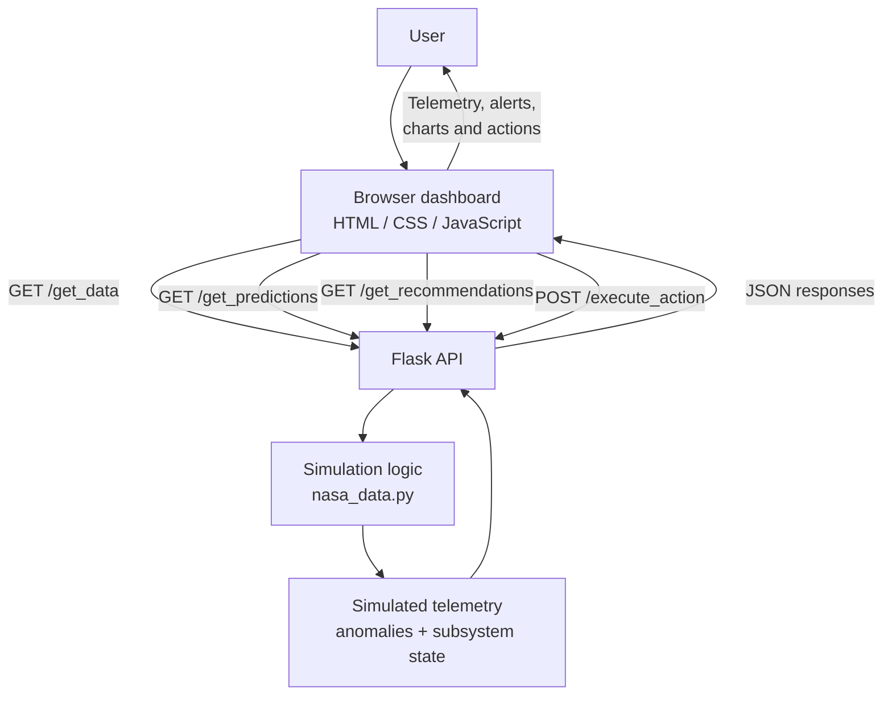

# ECLIPS — Environmental Control & Life Support System

ECLIPS is a NASA-inspired, web-based habitat life-support simulator. It presents a spacecraft-style operations dashboard where users can monitor simulated environmental telemetry, review system alerts, and respond to life-support anomalies.

The project is designed as an interactive learning experience around the kinds of environmental systems that help keep a crewed habitat safe.

> **Note:** ECLIPS is an educational simulation. Its telemetry, crew information, anomaly scenarios, and recommendations are simulated and should not be used for real spacecraft operations or safety decisions. It is not an official NASA product.

## Overview

The dashboard brings several habitat-support readings together in one interface, including:

- Cabin pressure
- Oxygen partial pressure
- Carbon dioxide concentration
- Cabin temperature
- Relative humidity
- Water reserves

The interface also presents subsystem status, telemetry trends, consumables estimates, crew information, and a stream of system alerts.

## Features

- **Live-style telemetry dashboard** — displays simulated environmental readings and their nominal ranges.
- **Telemetry trends** — view a chart for the selected metric.
- **Anomaly scenarios** — simulated CO₂, cabin-pressure, and temperature events can trigger warnings with different priority levels.
- **Recommendations and actions** — review suggested responses and submit an action for the active scenario.
- **Subsystem overview** — see status summaries for ventilation, CO₂ scrubbing, water processing, oxygen generation, thermal control, and waste management.
- **Mission and crew panels** — explore fictional mission details and crew profile information.
- **Spacecraft-inspired interface** — a multi-section dashboard for monitoring and exploring the simulation.

## Tech Stack

- **Python**
- **Flask 3**
- **HTML, CSS and JavaScript**
- **Chart.js** (for telemetry visualisation)

## Project Structure

The application is contained in the `eclips-main/` directory.

```text
ECLIPS/
├── README.md
└── eclips-main/
    ├── api/
    │   ├── index.py          # Flask routes and application entry point
    │   └── templates/
    │       └── home.html     # Dashboard interface
    ├── nasa_data.py          # Simulated telemetry and anomaly/action logic
    ├── requirements.txt      # Python dependencies
    └── vercel.json           # Vercel routing configuration
```

## Run Locally

### Prerequisites

- Python 3.10 or later
- pip

### 1. Clone the repository

```bash
git clone https://github.com/rohan-K210/ECLIPS.git
cd ECLIPS/eclips-main
```

### 2. Create and activate a virtual environment

**Windows (PowerShell):**

```powershell
python -m venv .venv
.venv\\Scripts\\Activate.ps1
```

**macOS / Linux:**

```bash
python3 -m venv .venv
source .venv/bin/activate
```

### 3. Install dependencies

```bash
pip install -r requirements.txt
```

### 4. Start the Flask application

From inside the `eclips-main/` directory, run:

```bash
python -m api.index
```

Open [http://127.0.0.1:5000](http://127.0.0.1:5000) in your browser. Flask debug mode is disabled by default; set `FLASK_DEBUG=1` only for local development when you explicitly need the debugger.

## Application Routes

| Route | Method | Purpose |
|---|---|---|
| `/` | GET | Serves the main dashboard |
| `/get_data` | GET | Returns the current simulated ECLSS metric readings |
| `/get_predictions` | GET | Returns details of the active anomaly scenario |
| `/get_recommendations` | GET | Returns the available response actions |
| `/execute_action` | POST | Processes a selected action |

The `/execute_action` endpoint expects a JSON object containing an integer `action_id`; malformed or missing values receive a `400` response. The endpoint is unauthenticated because this is a public educational simulation, so do not attach real operational controls or sensitive data to it.

## Architecture

The browser dashboard is the presentation layer. It polls the Flask API for
telemetry, scenario predictions, and recommendations. The Python simulation
module supplies the simulated readings and processes selected response actions.



## How the Simulation Works

1. The Flask application serves the dashboard.
2. The browser periodically requests telemetry and scenario information from the Flask API.
3. The Python simulation module generates nominal readings and applies the active anomaly scenario.
4. The dashboard displays the readings, alerts, and available response actions.
5. When an action is submitted, the backend processes it and updates the simulation state.

## Deployment

The repository includes a `vercel.json` configuration for routing requests to the Flask application on Vercel. To deploy, import this repository into Vercel and configure the project so that the deployment root is the `eclips-main/` directory.

Review the deployment logs and test the dashboard and API routes after deployment.

## Future Improvements

- Add screenshots and a short demonstration video.
- Expand the set of life-support anomaly scenarios.
- Improve the simulation model and make scenario outcomes more detailed.
- Add automated tests for API routes and simulation behaviour.
- Isolate simulation state per session or user before supporting concurrent independent missions.
- Improve accessibility and mobile dashboard layouts.

## Disclaimer

ECLIPS is an independent educational project inspired by environmental control and life-support concepts. It is not affiliated with, endorsed by, or representative of NASA. All displayed mission, crew, telemetry, and system data are fictional or simulated.

---

*Built to make complex life-support concepts easier to explore through an interactive simulation.*
